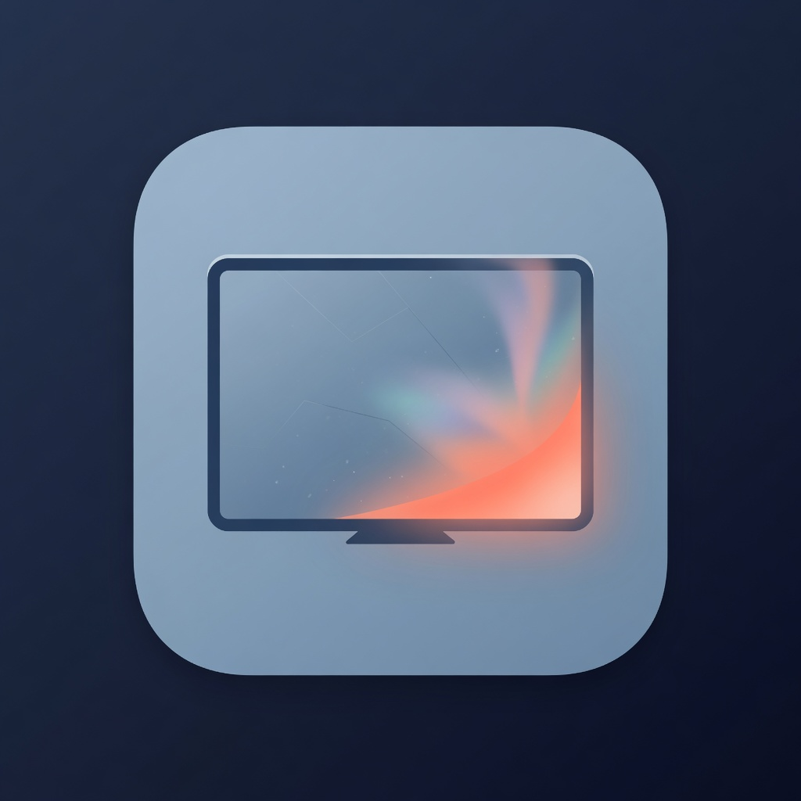

<div align="center">



# IdleScreen

**Capability-secured screensaver and idle management suite built natively in openOODA (`.oo`).**

[Website](https://idlescreen.github.io/) • [Documentation](https://idlescreen.github.io/) • [Packages Channel](https://github.com/idlescreen/packages) • [Core Monorepo](https://github.com/idlescreen/idlescreen)

</div>

IdleScreen (`v5.0.0`, built natively in **openOODA `.oo`**) is a zero-dependency, capability-secured screensaver and idle management suite for Linux (`339 KB` ELF) and Windows (`1.5 MB` `PE32+`). It features a unified single-binary architecture with an event-driven daemon at `0.00%` CPU at idle, a flat `2.62 MiB` 1,000-frame resident footprint via per-frame OODA arena reclamation (`@oo_arena_mark` / `@oo_arena_reset_mark`), default-deny capability security (`std/core/ooda.oo` + `std/sec/pqc.oo`), `18/18` bit-exact golden scene parity, an interactive TUI director (`idlescreen tui`), first-class **openOODA & SuperFedora** integration, and a clean OS-only (or custom text) 16-bit arcade wordmark across **53 built-in 16-bit arcade, demoscene, and mathematical scenes**.

---

## Repositories & Architecture

### Core Active Repositories
| Repository | Role |
|---|---|
| [**idlescreen**](https://github.com/idlescreen/idlescreen) | **Core Monorepo (`v5.0.0` — Native openOODA `.oo`)**: Unified single-binary screensaver suite containing the daemon, CLI, TUI director, and 53-scene 16-bit arcade engine. |
| [**packages**](https://github.com/idlescreen/packages) | **Package Channel & Automation**: Signed package repositories (APT, RPM, Arch Linux PKGBUILD), cryptographic verification, and the universal `install.sh` bootstrap. |
| [**idlescreen.github.io**](https://github.com/idlescreen/idlescreen.github.io) | **Product Website**: Web showcase, 53-scene interactive matrix, documentation, and download portal. |

### Specialized & Companion Repositories
| Repository | Role |
|---|---|
| [**studio**](https://github.com/idlescreen/studio) | **Offline Video Engine & Director**: Headless rendering pipeline to AV1/H.264 video (`idle-studio`). |

---

## Quick Install

```sh
curl -fsSL https://idlescreen.github.io/install.sh | sh
```

Verify installer SHA-256 before running:
```sh
curl -fsSL https://idlescreen.github.io/install.sh -o install.sh
./install.sh --verify
./install.sh
```

---

## Core Commands

```sh
idlescreen status                  # check daemon, inhibitor, and screensaver status
idlescreen preview [saver] --tour  # preview or tour all 53 scenes (Left/Right or n/p to step)
idlescreen text [text | --clear]   # set custom banner text or reset to OS-only wordmark
idlescreen tui                     # launch interactive 53-scene configuration dashboard
idlescreen list                    # list all 53 built-in 16-bit arcade & mathematical scenes
idlescreen inhibitors              # inspect active D-Bus / portal / audio idle inhibitors
idlescreen service install         # install user service (systemd, openrc, runit, s6, dinit, xdg)
idlescreen doctor --fix            # diagnose and auto-remediate Wayland, socket, and service issues
idlescreen config                  # display active TOML configuration
```

---

## License

Apache-2.0 · © 2026 IdleScreen
