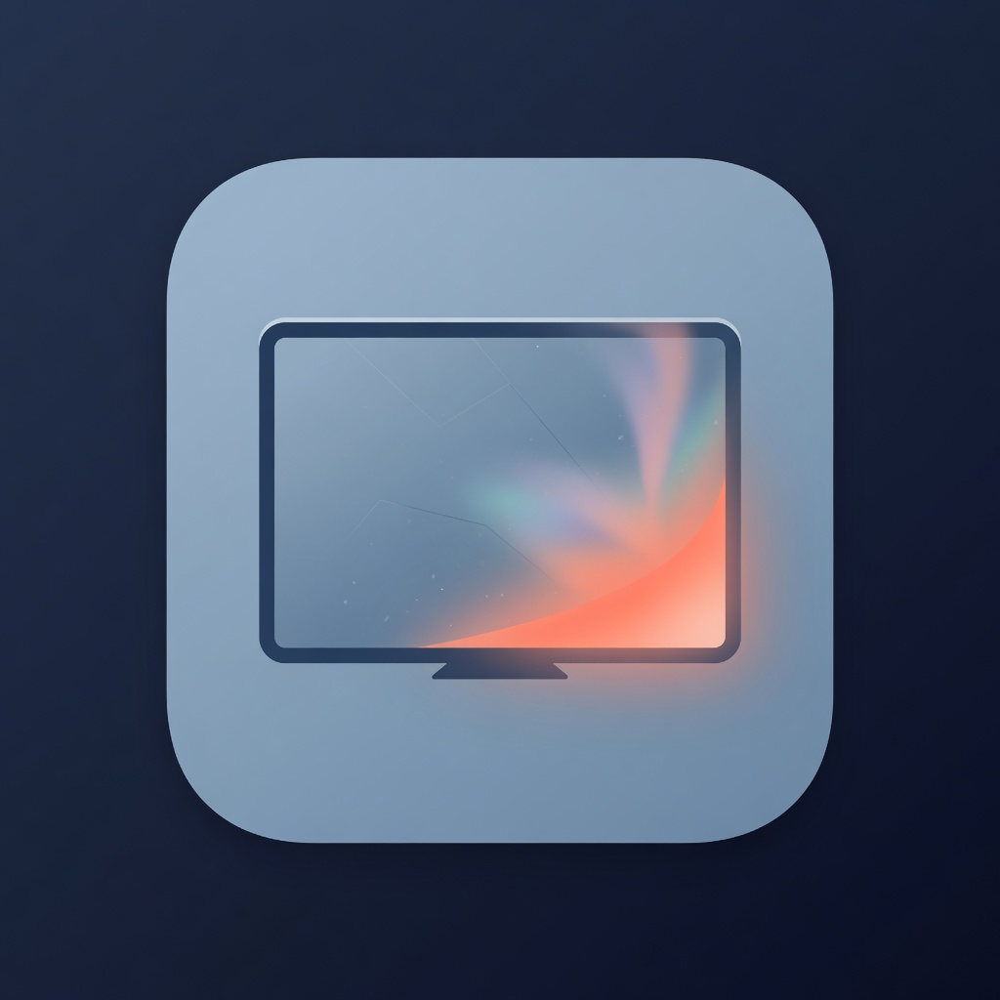

<div align="center">



# IdleScreen

**High-performance Wayland-native idle screen and ambient screensaver suite for Linux.**

[Website](https://idlescreen.github.io/) • [Documentation](https://idlescreen.github.io/) • [Packages Channel](https://github.com/idlescreen/packages) • [Core Monorepo](https://github.com/idlescreen/idlescreen)

</div>

IdleScreen provides zero-waste ambient displays and screensavers for Linux desktops on Wayland. It features an event-driven daemon with zero wakeups while active, dynamic 60–144 Hz monitor refresh rate matching, responsive 400% ASCII font scaling, and 37 punchy in-tree visual scenes.

---

## Repositories & Architecture

### Core Active Repositories
| Repository | Role |
|---|---|
| [**idlescreen**](https://github.com/idlescreen/idlescreen) | **Core Monorepo**: Unified high-performance screensaver suite containing the daemon, CLI, TUI, built-in 37-scene ASCII engine with dynamic 60–144 FPS matching, and optional `idlescreen-extras`. |
| [**packages**](https://github.com/idlescreen/packages) | **Package Channel & Automation**: Signed package repositories (APT, RPM, Arch Linux PKGBUILD), cryptographic verification, and the universal `install.sh` bootstrap. |
| [**idlescreen.github.io**](https://github.com/idlescreen/idlescreen.github.io) | **Product Website**: Web showcase, live visual preview, documentation, and download portal. |

### Specialized & Companion Repositories
| Repository | Role |
|---|---|
| [**cosmic**](https://github.com/idlescreen/cosmic) | **COSMIC Panel Applet**: Native panel integration and status applet for the System76 COSMIC Desktop (`libidle_cosmic.so`). |
| [**studio**](https://github.com/idlescreen/studio) | **Offline Video Engine & Director**: Headless rendering pipeline to AV1/H.264 video (`idle-studio`). |

### Archived Legacy Repositories
> [!NOTE]
> The standalone legacy crates [**`cli`**](https://github.com/idlescreen/cli), [**`tui`**](https://github.com/idlescreen/tui), [**`runtime`**](https://github.com/idlescreen/runtime), and [**`savers`**](https://github.com/idlescreen/savers) have been consolidated into the [**`idlescreen`**](https://github.com/idlescreen/idlescreen) monorepo (`/usr/bin/idlescreen`) and are archived on GitHub. They are preserved in read-only mode for historical reference and ABI lineage.

---

## Quick Install

```sh
curl -fsSL https://idlescreen.github.io/install.sh | sh
```

Verify installer SHA-256 before running:
```sh
curl -fsSL https://idlescreen.github.io/install.sh -o install.sh
./install.sh --verify
./install.sh
```

---

## Core Commands

```sh
idlescreen status            # check daemon and screensaver status
idlescreen preview [saver]   # preview any screensaver in terminal or fullscreen (e.g. fireworks, matrix)
idlescreen doctor            # diagnose Wayland session, sockets, D-Bus, and configuration
idlescreen tui               # launch interactive configuration dashboard
idlescreen list              # list available built-in and extras screensavers
idlescreen config            # display active TOML configuration
```

---

## License

Apache-2.0 · © 2026 IdleScreen
